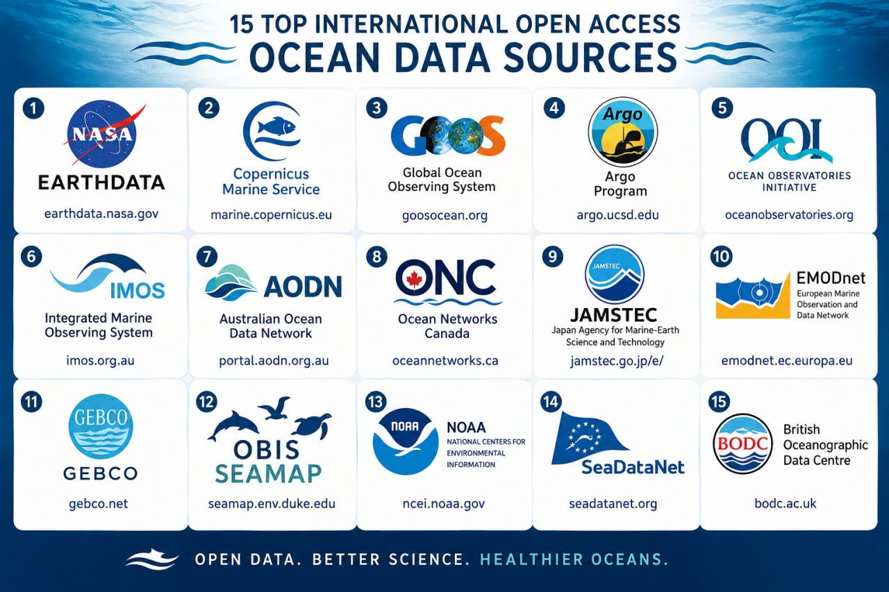

```{r setup, include=FALSE}
knitr::opts_chunk$set(echo = TRUE)
```

# Introduction

Today we'll take a look at some some ways to get environmental data for
your seascape analyses. These are only a few options, there are many out
there; finding them requires a bit of research: Google and patience are
your friends. Also, keep an eye out for linked datasets in any papers
you read. Right at the end of this tutorial, I have listed some datasets
that students used in previous years.

This step (finding data) can sometimes be difficult and frustrating. Go
easy on yourself: stay patient and ask for help, from your classmates,
me and Josh, or the internet.

Ask me and Josh about different datasets that you might want to use.
Usually every new dataset requires a bit of 'wrangling' to get it to
work. Be patient with that step--it's an integral part of data science!

# Bathymetry data

## Using the marmap package

Refer back to Lab 04 where you practiced using the `marmap` package
(<https://cran.r-project.org/package=marmap>) to download bathymetry
data. You could also download data manually from NOAA
(<https://www.ncei.noaa.gov/products/etopo-global-relief-model>) or
GEBCO
(<https://www.gebco.net/data_and_products/gridded_bathymetry_data/>).

# Environmental data

## Copernicus Marine

<https://data.marine.copernicus.eu/products>

### How to work with files from Copernicus Marine

<https://marine.copernicus.eu/services/user-learning-services/using-r-work-copernicus-marine-data>

This tutorial by [David
March](https://scholar.google.com/citations?user=xABsDpAAAAAJ&hl=en&oi=ao)
has a step-by-step video and the associated materials are available at:
<https://atlas.mercator-ocean.fr/s/dCTPqL77Ydposfi>. The NetCDF (`.nc`)
file that David downloads (`download.file()` function) and then reads in
(`nc_open()` function) is hosted on his Github page (and is also
contained in the training materials), but is originally downloaded
directly from Copernicus Marine. For example, you can look at all the
products with a global spatial coverage at:
<https://data.marine.copernicus.eu/products?facets=areas%7EGlobal+Ocean>

Once you have selected a data product you are interested in, click on
the 'data access' button in the toolbar on the left, which load a more
detailed page with different download options. You will need to register
for a free account first. You could, for example, click on the 'Browse'
links in the 'Files' column to access the folder and raw files directly
using your browser (e.g.,
<https://data.marine.copernicus.eu/product/GLOBAL_ANALYSISFORECAST_BGC_001_028/files>)
or 'Form' links in the 'Subset' column to enter parameters (like spatial
and temporal extent) and then download the resulting `.nc` file. This
webpage has more details about how to use the Graphical User Interface
to download data:
[https://help.marine.copernicus.eu/en/articles/8078281-how-to-download-copernicus-marine-products-using-our-graphical-user-interfaces](https://help.marine.copernicus.eu/en/articles/8078281-how-to-download-copernicus-marine-products-using-our-graphical-user-interfaces#h_a270cbfc6d){.uri}
(probably the easiest option).

You can explore the dataset visually by clicking on the map icon at top
right.

[](Figure%201)

You could also explore and download products through their MyOcean Pro
visualisation tool: <https://data.marine.copernicus.eu/viewer/expert>.

As David says in his tutorial, there is an R package called RCMEMS
(<https://github.com/markpayneatwork/RCMEMS>) to download these files
directly through R, but it is fairly complex to set up, since you need a
Python installation on your machine. Only for advanced users...

Remember, you should read and understand the product overview (e.g.,
<https://data.marine.copernicus.eu/product/GLOBAL_ANALYSISFORECAST_PHY_001_024/description>)
and you will need to give these details in a report (like your workflow
assessment, see the marking rubric) or paper. You can cite the product
using the DOI (for example, <https://doi.org/10.48670/moi-00016>).

Once you have worked through David's tutorial, try with your own data
product that you choose from Copernicus Marine.

## NOAA

### ERDDAP

NOAA provides its gridded datasets through a server called
[ERDDAP](https://upwell.pfeg.noaa.gov/erddap/index.html).

You can see the datasets (what we called 'products' above) here:
<https://coastwatch.pfeg.noaa.gov/erddap/griddap/index.html?page=1&itemsPerPage=1000>.
You can use that page to get the data by clicking the 'data' link in the
leftmost column for a given product (the column is called 'Grid DAP
Data'), choosing the temporal and spatial extent, selecting `.nc` in the
file type dropdown, and then clicking 'Submit'. You can do an advanced
search on the page to find what you're looking for
(<https://coastwatch.pfeg.noaa.gov/erddap/search/advanced.html?page=1&itemsPerPage=1000&protocol=griddap>).

For example, I went to the search page, typed "chlorophyll global" in
the "Full Text Search for Datasets" box, then clicked on the 'data' link
for the result with this title: "Chlorophyll-a, Aqua MODIS, NPP, L3SMI,
Global, 4km, R2022 NRT, 2003-present (Monthly Composite)". As for
Copernicus Marine above, it's important to read the product details. You
can get that information by clicking on the 'background' link in the
'Background Info' column. This link should take you directly to the
product data access page:
<https://coastwatch.pfeg.noaa.gov/erddap/griddap/erdMH1chlamday_R2022NRT.html>
(and the background info. is at <https://oceandata.sci.gsfc.nasa.gov/>,
but it's not so informative in this case).

Take note of the dataset ID found near the top of the page and also in
the website URL: 'erdMH1chlamday_R2022NRT'. You can use this ID later in
the `rerddap` package. I left the time dimension as-is, and I left the
latitude and longitude as-is. This should give me the latest available
global file. Select '.nc' in the File type dropdown, and click 'Submit'.

[](Figure%202)

Be patient once you have clicked submit, it takes a while. This
generates a pretty big file (\~150 MB) that you can download. You may
wish to change the spatial extent (the latitude and longitude) so the
download is smaller. I changed mine to -20 - +20 latitude and -10 - +10
longitude for this example.

Notice you can also generate a link by clicking 'Just generate the URL'.
In my case this gave:

[`https://coastwatch.pfeg.noaa.gov/erddap/griddap/erdMH1chlamday_R2022NRT.nc?chlorophyll%5B(2022-11-16T00:00:00Z):1:(2022-11-16T00:00:00Z)%5D%5B(20):1:(-20)%5D%5B(-10):1:(+10)%5D`](https://coastwatch.pfeg.noaa.gov/erddap/griddap/erdMH1chlamday_R2022NRT.nc?chlorophyll%5B(2022-11-16T00:00:00Z):1:(2022-11-16T00:00:00Z)%5D%5B(20):1:(-20)%5D%5B(-10):1:(+10)%5D)

We can read the file into R using the `raster` package.

If you can't get the above step to work, both this file and the one
downloaded in the next section are uploaded on Blackboard. You should
save them in a folder called 'resources' inside your working directory
(or modify the path names, removing the `resources` part).

```{r}
library(raster)
library(terra)

chl <- terra::rast("./resources/erdMH1chlamday_R2022NRT_2b95_1e81_5998_U1670403378531.nc")

# Plot to check
plot(chl)

# We could also read it in directly from the URL:
# Note that you will need to create a folder (in your working directory)
# called 'resources'. Or, you can modify the 'destfile =' argument,
# taking out the "resources/" part.
my_file <- download.file(url = "https://coastwatch.pfeg.noaa.gov/erddap/griddap/erdMH1chlamday_R2022NRT.nc?chlorophyll%5B(2022-11-16T00:00:00Z):1:(2022-11-16T00:00:00Z)%5D%5B(20):1:(-20)%5D%5B(-10):1:(+10)%5D",
                         destfile = "./resources/my_chl.nc")

# And read it in
chl <- terra::rast("./resources/my_chl.nc")

# Plot it
plot(chl)
```

A more detailed tutorial is provided here:
<https://coastwatch.gitbook.io/satellite-course/tutorials/r-tutorial/1.-how-to-work-with-satellite-data-in-r>

We can get also get data from the ERDDAP server using the `rerddap`
package (<https://docs.ropensci.org/rerddap/>). The CoastWatch tutorial
above includes rerddap tutorials, and rerddap has two vignettes:

<https://cloud.r-project.org/web/packages/rerddap/vignettes/rerddap.html>

<https://cloud.r-project.org/web/packages/rerddap/vignettes/Using_rerddap.html>

There are also some general tutorials like the following:

<https://cran.r-project.org/web/packages/heatwaveR/vignettes/OISST_preparation.html>

### Ocean Color Data

<https://oceandata.sci.gsfc.nasa.gov/>

You can use the NASA Ocean Color L3 browser:
<https://oceancolor.gsfc.nasa.gov/l3/>

# Other data sources

If you encounter a product you're interested in using, speak to me or
Josh about how to access and use the data for your assessment.

These are some of the datasets that Seascapers have used previously:

- Animal tracking data from
  [Movebank](https://www.movebank.org/cms/movebank-main) (refer to the
  animal movement lab for links to Movebank tutorials). You can interact
  directly with Movebank using the
  [move2](https://bartk.gitlab.io/move2/) R package.

- Coral reef monitoring data from
  [AIMS](https://apps.aims.gov.au/metadata/view/c30cfb2d-46be-4837-9733-9bb60489b65b)

- Northern hemisphere [sea-ice
  concentration](https://polarwatch.noaa.gov/erddap/files/nsidcG02202v4nhmday/)

- Data on coral beaching from
  [here](https://upwell.pfeg.noaa.gov/erddap/griddap/dhw_5km.html) and
  [here](https://coralreefwatch.noaa.gov/product/5km/index_5km_composite.php)

- Sea surface temperature data from
  [Copernicus](https://doi.org/10.48670/moi-00037)

- Data on the potential habitat of
  [sardines](https://coastwatch.pfeg.noaa.gov/erddap/griddap/sardine_habitat_modis.html)

Often, papers will publish the data they used to do their work.

Remember, you need to fully cite your data source, and you'll need to
report its characteristics (like spatiotemporal extent and resolution).
Refer the the marking rubric for the assignment.

## Ocean Science Analytics's Top-15 Open-Access Ocean Data Sources

(from
<https://www.linkedin.com/feed/update/urn:li:share:7476006583697633280/>)

[](https://www.linkedin.com/feed/update/urn:li:share:7476006583697633280/)

\
1. [**NASA - National Aeronautics and Space
Administration**](https://www.linkedin.com/company/nasa/) Earthdata –
Ocean color, sea surface temperature, sea level, winds, and many other
Earth observation datasets.\
[**https://lnkd.in/gDG53zV**](https://www.linkedin.com/safety/go/?url=https%3A%2F%2Flnkd%2Ein%2FgDG53zV&urlhash=wk5S&mt=adijh0xGcksl-D_-GgJ69aymLxOD3ProwDyle7R1XgWfm4CtomdN4035df7t5f1Z7Wv58xLEUXlSDcAmf2CzKWtHBJoCN1sMlUiQseFgC5QY7H8-VYWUhVeIfroL9O-26bRpoKURkyvTz20m0ZyQz6Q555x8zginqonFb7-nHLLdNO3kTXCXIE2vuPFR1Q_YdA&isSdui=true)\
\
2. [**Copernicus Marine
Service**](https://www.linkedin.com/company/copernicus-marine-service/)
(CMEMS) – Global and regional physical, biogeochemical, and ocean
forecast products.\
[**https://lnkd.in/e7rQ_gCV**](https://www.linkedin.com/safety/go/?url=https%3A%2F%2Flnkd%2Ein%2Fe7rQ_gCV&urlhash=vIVV&mt=rLlBlYT3jDZeuGVpjEGb2YVB6AfJWQi699KWTSZQk080CJnXCgJsDnh2m90LCvhSV4vKTdm03fKXGv-i3DnYKcXmkPKyjKmqvYnDw3WX_3Q2lwJOQ0T_fL_dcFGuK6JB4vqZoasxgzWLDE0gVXWS2vny04d8fJDNs5u2n6Rf1MmXuSOVk4apW92j4aJzDsf4Vw&isSdui=true)\
\
3. [**Global Ocean Observing System
(GOOS)**](https://www.linkedin.com/company/global-ocean-observing-system/)
– International coordination of ocean observing systems and data
networks.\
[**https://goosocean.org/**](https://www.linkedin.com/safety/go/?url=https%3A%2F%2Fgoosocean%2Eorg%2F&urlhash=XZCT&mt=ml7YtZoW31zqIuA1TXZYGWyprzeE1iP5CnOMfKMol8JqFVVTozUaXSG3rNl9Efeejz4KXo4HnNAjKJXE-D6dOTaU_Jns8F4ucubba6105jIFnbqMGNw0w26fHfpP-sjWfIzpHUwu89NN9t1HJZsEkGrLLV9CTf5zFaIxw9lS-MFDbhbbc5TzNYlOOGSh_wGZvg&isSdui=true)\
\
4. Argo Program – Autonomous profiling floats measuring temperature,
salinity, oxygen, and more.\
[**https://argo.ucsd.edu/**](https://www.linkedin.com/safety/go/?url=https%3A%2F%2Fargo%2Eucsd%2Eedu%2F&urlhash=K0aS&mt=SGTDwmgig041l5Wufm8gaf2rkpXi6bqeK5oIJFRHCiIyC2SBiTLdObByS2gho8zH0HJikl9ifBtGb-oXj8kKAm8wDb6nURHx39XgywtMTDD9YZOzAgV0lUwKcAFInuducyyh_DGmgVGr1C17eCS3h2IgnFNTsnG930EZEWpgLUFwavvYRU8HJoGNX6MXFtk7Lw&isSdui=true)\
\
5. [**Ocean Observatories
Initiative**](https://www.linkedin.com/company/ocean-observatories-initiative/)
(OOI) – Open-access mooring, glider, cabled array, and hydrophone
observations.\
[**https://lnkd.in/eHeJbAQ**](https://www.linkedin.com/safety/go/?url=https%3A%2F%2Flnkd%2Ein%2FeHeJbAQ&urlhash=-UvP&mt=LpUOk4ezGSvyAhzFFAisL2_Buf6sP7UOUWR41UADPoE1dwrCXMfseRyBOY5wqeHeyEpsATc4Os7yDKU3686GPEOOPfjZbhc7GEgwXTQ00N26SnpQ1nRncJQ2O6fzvuMciJj8OssR6uXlEzwcpeCbYesyBPMQqejOvKcRNRjbNQbMTmDY8l81GbcMsOPQTDlJuA&isSdui=true)\
\
6. [**Integrated Marine Observing
System**](https://www.linkedin.com/company/imos_aus/) (IMOS) –
Australia's national ocean observing network, providing biological,
physical, acoustic, and biogeochemical observations.\
[**https://imos.org.au/**](https://www.linkedin.com/safety/go/?url=https%3A%2F%2Fimos%2Eorg%2Eau%2F&urlhash=QouZ&mt=ewWxbG5e2PmG9-YTUpfyfOnnIdg_JPQAx0sZ8_C6DkajpoK8KHfX-1M02h-Q7syT5ak7kBk0YB1SuCcG-Obr0ZdON072menH5ipAJYFZ7jeRoBmCN7wL049S_OTUfRGHxFNTFiA9wrEyTi2WgGpEN2wTUSjgq8Fq34PAaYA8pf14r43DbTr-OEwJQvdeowPqXQ&isSdui=true)\
\
7. [**GBIF: The Global Biodiversity Information
Facility**](https://www.linkedin.com/company/gbif/) – Global
biodiversity occurrence records, including marine species.\
[**https://www.gbif.org/**](https://www.linkedin.com/safety/go/?url=https%3A%2F%2Fwww%2Egbif%2Eorg%2F&urlhash=YQhm&mt=gx3LHQz-SSwtxd6ZjyYWSREQwAwTK_h5YZdeI7lhrURpFWv4ql15ojlA_GtvDNp3rVdTvJXZ7TfhxaNSPt-b20DV4LcwZFckfFF15lk1mgUDDEIZgDx47mO4leRwKs5Q7Aof_Yn-WxSUIdiZbsgxL0bCR0hZHNJGVCWwKBOQe9efph3LfFLXnfB57vEHjp2ZKA&isSdui=true)\
\
8. [**Ocean Networks
Canada**](https://www.linkedin.com/company/ocean-networks-canada/) (ONC)
– Continuous ocean observations from cabled observatories, including
hydrophone recordings.\
[**https://lnkd.in/dWxd2K_y**](https://www.linkedin.com/safety/go/?url=https%3A%2F%2Flnkd%2Ein%2FdWxd2K_y&urlhash=n6hG&mt=aLvJaFEPR4myKqVLCCq_dzXM0Sq6Uk2WXrKdRONll-MchZijfERf-Jo_Vyy-_D6wb2EInsBVbih22pPT6nYNq4Zx2qMpAnzGd7nF9ISnY_24shc81WVzPyL-BJlDgNw3GIgInAp66hibh5mQJXHdTF2CBC8q6cgEILdfeg-72OSwsFyFmJ-_Bo8tEmaaF1vL8A&isSdui=true)\
\
9. [**JAMSTEC: Japan Agency for Marine-Earth Science and
Technology**](https://www.linkedin.com/company/japan-agency-for-marine-earth-science-and-technology-jamstec/)
Data Portal – Oceanographic, climate, deep-sea, and marine geology
datasets from Japan.\
[**https://lnkd.in/g62HUvsG**](https://www.linkedin.com/safety/go/?url=https%3A%2F%2Flnkd%2Ein%2Fg62HUvsG&urlhash=FVTW&mt=t-FcRFQ65lfQMY4GMiglRwn2Z3QzDSw-ISObA2jAjMLxzFHVJwdP68RlFdfiJCCv5IayeIw-P-GT_Wq0mcFe4zwrYP7exVVINb-XWP6RMhlIU0AohA2xkm4oPLnZr2LLXTJyeXgU4hmwiAb6__qCVDFXUaPLSgUvLhkRtQipPq93SkxCd7Ifkdt6QofhjRbhjQ&isSdui=true)\
\
10. [**EMODnet**](https://www.linkedin.com/company/emodnet/) – European
Marine Observation and Data Network covering bathymetry, biology,
chemistry, habitats, geology, and human activities.\
[**https://lnkd.in/eWbcfadm**](https://www.linkedin.com/safety/go/?url=https%3A%2F%2Flnkd%2Ein%2FeWbcfadm&urlhash=07s_&mt=YkfLOw7qL85OAfUEJ--a5lhqtAdPLHVU_HIumrbYy_J4Rfsu68L9grWPEUhF7O-5dHzVJ8-9QAwhnUrFWvqptww74aHOqA0aqHdFbUoIlqzZK7tq1hYtj9UY6tcxqQPVRx_I_pD4mQyFgbGWJa73x7uUXRv6MJ8oPPnD6JJcbe93IlUoUd3msbdWXFKg5TdWoA&isSdui=true)\
\
11. [**GEBCO - General Bathymetric Chart of the
Oceans**](https://www.linkedin.com/company/gebcooceanmap/) – The world's
most comprehensive publicly available bathymetry.\
[**https://www.gebco.net/**](https://www.linkedin.com/safety/go/?url=https%3A%2F%2Fwww%2Egebco%2Enet%2F&urlhash=kOlz&mt=1KBjIvWSzhWhqzfV5fcxOr-pHFE1vSZSKDy7nOJTvZNjTNKGgsMjef-z7aC7XKhc9TOY5X4fJlDmlkGBru-p_FqbStDRDyce3WfGrSB6xu8gI0Bh37Uv6zVW90vRpQygrpYe314gl0r_YIdzctUutKzaWbDJnI2MiRlzV-zMPn9W7-r0h1uV9stJukVBQtwR_g&isSdui=true)\
\
12. OBIS-SEAMAP – Marine mammal, seabird, and sea turtle observations.\
[**https://lnkd.in/gEwwiV95**](https://www.linkedin.com/safety/go/?url=https%3A%2F%2Flnkd%2Ein%2FgEwwiV95&urlhash=eTfA&mt=kRfXLZ_BddOxe0_a_BVK62JcpvtbfcpX2UVDRCqCByJWW88WnECqz0LOasFGDZoiCx7iGB8FPIKxDxRJahUuqgwJ2RPuAsZ9TCHYi5epZNyiims80QGN4CzjWlZVSTmbMY08z1XhaEU8BSHN0K-Y_Mp9ieEwKlD4P1l_7dhuzrPCqxNKHSrUn3ObD-dPuHfYeg&isSdui=true)\
\
13. NOAA National Centers for Environmental Information (NCEI) – One of
the world's largest repositories of oceanographic, fisheries, climate,
and bathymetric datasets.\
[**https://www.ncei.noaa.gov/**](https://www.linkedin.com/safety/go/?url=https%3A%2F%2Fwww%2Encei%2Enoaa%2Egov%2F&urlhash=183o&mt=RG-6JhP-wZr3SSEhBbHpQpomJlEBa13JXBr1wHX-dkWH1N-gts19MCom7LECDaaaQicnIoM2lbdZ-V8f7sb0xbJENNuUv00mGq1knwVjJcbROU9TPVen3nRH81S_fuVH2KV8mq0e65iE8Icr-YUi2v_hwMgyvF6xrd9-JKnZnBvhJ4H6oYOQsM4kmWw9-i_DkA&isSdui=true)\
\
14. SeaDataNet – A pan-European infrastructure providing standardized
access to marine environmental data from over 100 organizations.\
[**https://lnkd.in/gw-Fdh4v**](https://www.linkedin.com/safety/go/?url=https%3A%2F%2Flnkd%2Ein%2Fgw-Fdh4v&urlhash=5l2T&mt=Fo5MdVVFyHaArbRgcxkzzfaKTs43hmxZcvEYzwFhVsqgwgDIxn5inU3Kz6InA-h7ooWoHpsJo3dkdl_lm4rJ0brbo7oPeyd5gjyusx3x6y2ovlftZC2e6cuBYJ_2LRgbL4fgUliprBEEw0qx3jXKjaaN4f6w-amPXKUPIOVnlYh-DUg5YUD88BVsu_GN2Z225g&isSdui=true)\
\
15. [**British Oceanographic Data
Centre**](https://www.linkedin.com/company/british-oceanographic-data-centre/)
(BODC) – Long-term marine observations, cruises, moorings, and
oceanographic datasets from the UK and beyond.\
[**https://www.bodc.ac.uk/**](https://www.linkedin.com/safety/go/?url=https%3A%2F%2Fwww%2Ebodc%2Eac%2Euk%2F&urlhash=hSVn&mt=OoiG0FDebGWp39qx0nXaq5b1xzYzWsHkQS2die0dfxjgLdj_YbOtxaHJx-sY8IcxT5I2VVJE_vC4QF2xqrNFYWM0pbQP5-dFAVV2ulsd7CmV88fa8venVIzevLNwOpR9bSVtlH1meoezMhMKWjqWZyRke0cCbNcOMeTvh8vFm7UCPz-rhPqyyNZ_JXT8PHH3ZA&isSdui=true)

# Practice

Start playing around with these data sources, and start thinking about
what you want to do for your assessment. Josh and I will walk around to
answer questions, and next week is a drop-in session where you can bring
your ideas and/or datasets for help.
