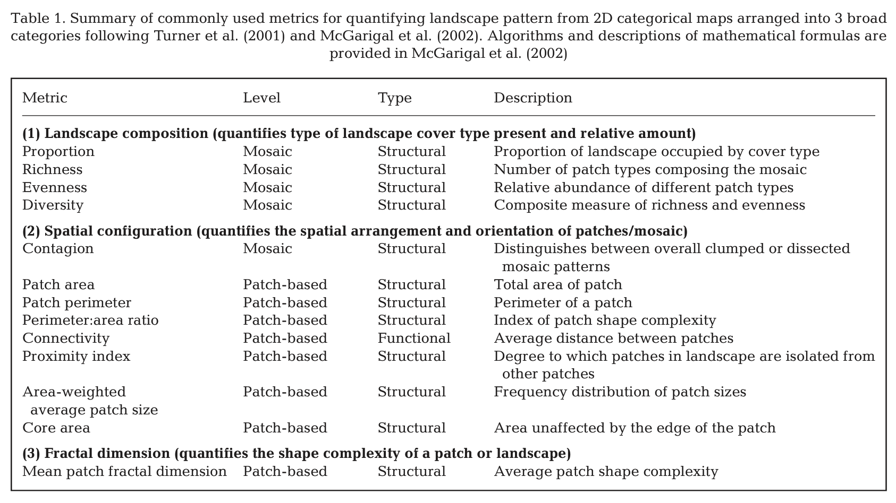

```{r setup, include=FALSE}
knitr::opts_chunk$set(echo = TRUE)
```

# Introduction

Today we will look at a short example of using the `landscapemetrics` R package to calculate patch metrics from raster data. Remember, patch metrics are measures of the size, shape, and configuration of patches of habitat. This applies to the patch-mosaic and patch matrix models.

The package implements metrics from a computer programme called FRAGSTATS (<https://www.fragstats.org/>), which is widely used in landscape ecology. The package can calculate a wide variety of landscape metrics at the patch, class, and landscape levels.

The package's website has some general background: <https://r-spatialecology.github.io/landscapemetrics/articles/general_background.html>

The paper describing the package can be found here: <https://doi.org/10.1111/ecog.04617>

```{r}
# Load packages
library(terra)
library(landscapemetrics)
library(dplyr)
```

# Exploring the built in landscape data

First, we'll get some data. `landscapemetrics` has a few built-in datasets. Let's use `podlasie_ccilc`, which is a land cover map of the Podlasie region of Poland. The data come from the **ESA Climate Change Initiative (CCI) Land Cover** project, which **provides global annual land cover maps at a 300-meter spatial resolution** <https://maps.elie.ucl.ac.be/CCI/viewer/> Overall, there are 22 global land cover classes, of which we have 14 in the Podlasie data. You can see the legend for the classes here: <https://maps.elie.ucl.ac.be/CCI/viewer/download/CCI-LC_Maps_Legend.pdf>. These are:

| Value | Landscape class |
|------------------------------------|------------------------------------|
| 0 | No Data |
| 10 | Cropland, rainfed |
| 11 | Herbaceous cover |
| 12 | Tree or shrub cover |
| 20 | Cropland, irrigated or post-flooding |
| 30 | Mosaic cropland (\>50%) / natural vegetation (tree, shrub, herbaceous cover) (\<50%) |
| 40 | Mosaic natural vegetation (tree, shrub, herbaceous cover) (\>50%) / cropland (\<50%) |
| 50 | Tree cover, broadleaved, evergreen, closed to open (\>15%) |
| 60 | Tree cover, broadleaved, deciduous, closed to open (\>15%) |
| 61 | Tree cover, broadleaved, deciduous, closed (\>40%) |
| 62 | Tree cover, broadleaved, deciduous, open (15–40%) |
| 70 | Tree cover, needleleaved, evergreen, closed to open (\>15%) |
| 71 | Tree cover, needleleaved, evergreen, closed (\>40%) |
| 72 | Tree cover, needleleaved, evergreen, open (15–40%) |
| 80 | Tree cover, needleleaved, deciduous, closed to open (\>15%) |
| 81 | Tree cover, needleleaved, deciduous, closed (\>40%) |
| 82 | Tree cover, needleleaved, deciduous, open (15–40%) |
| 90 | Tree cover, mixed leaf type (broadleaved and needleleaved) |
| 100 | Mosaic tree and shrub (\>50%) / herbaceous cover (\<50%) |
| 110 | Mosaic herbaceous cover (\>50%) / tree and shrub (\<50%) |
| 120 | Shrubland |
| 121 | Evergreen shrubland |
| 122 | Deciduous shrubland |
| 130 | Grassland |
| 140 | Lichens and mosses |
| 150 | Sparse vegetation (tree, shrub, herbaceous cover) (\<15%) |
| 151 | Sparse tree (\<15%) |
| 152 | Sparse shrub (\<15%) |
| 153 | Sparse herbaceous cover (\<15%) |
| 160 | Tree cover, flooded, fresh or brakish water |
| 170 | Tree cover, flooded, saline water |
| 180 | Shrub or herbaceous cover, flooded, fresh/saline/brakish water |
| 190 | Urban areas |
| 200 | Bare areas |
| 201 | Consolidated bare areas |
| 202 | Unconsolidated bare areas |
| 210 | Water bodies |
| 220 | Permanent snow and ice |

```{r}
# Get landscape data
# The terra::unwrap() function processes this kind of raster dataset
my_dat <- terra::unwrap(podlasie_ccilc)

# Plot to check
plot(my_dat)
```

Notice that terra's generic plot function has given us colours on a continuous scale. It is treating the land cover classes, which have numbers, as continuous values. We could fix that by explicitly converting the raster to factors instead.

```{r}
# Convert raster to categorical/factor
my_dat <- as.factor(my_dat)

# Define discrete colours
# Here, I already know, from the next chunk below, that I need 14 colours
# "Set 3" is the name of a discrete colour
# palette: see https://blog.r-project.org/posts/hcl-colors/index.html)
cols <- hcl.colors(14, "Set 3")

# Plot again, with our defined colours
plot(my_dat, col = cols)
```

> **Challenge yourself.** In the raster and plot above we still have the generic class labels instead of the more meaningful names in the legend above. Ask a genAI tool to help you write code to give this raster object the real names of the land class categories from the table above.

It's recommended to first use the `check_landscape()` function to make sure your raster is in the right format for analysis with the `landscapemetrics` package. (Note: we'll keep using the `my_dat` object, with factors).

The requirements to calculate meaningful landscape metrics are:

- The distance units of your projection are meters, as the package converts units internally and returns results in either meters, square meters or hectares. For more information see the help file of each function (e.g., in R run `?check_landscape`).

- Your raster encodes landscape classes as integers (1, 2, 3, 4, ..., n).

- Landscape metrics describe categorical landscapes, that means that your landscape needs to be classified (the package throws a warning if you have more than 30 classes to make sure you work with a classified landscape).

```{r}
check_landscape(my_dat)
```

From the table that this function returns we can see that:

✔ Our raster is categorical (it has integer values)

✖ It's not in a projected coordinate system: the CRS is 'geographic' and the units are 'degrees' (it would be 'meters' if it was projected). Remember back to Lab 3. Let's fix that. [Choosing a coordinate reference system is quite specific](https://learn.arcgis.com/en/projects/choose-the-right-projection/), but let's choose a global, general projection for this excercise. We'll use the Robinson projection, which is a global projection that roughly preserves area and shape. It's not perfect, but it's a good compromise for global data. I found the 'proj4' string for this projection on the <https://epsg.io/53030> website. Note, we must set the `method` argument to equal `near` -- nearest neighbour interpolation -- otherwise when the reprojection occurs, the raster values will be changed from integer values to numeric values (remember from the line above, our raster must have integers, or whole numbers, representing the different classes).

```{r}
# Use the project function to reproject the data
# The argument 'y' is the projection 'proj4' string, which I got from the
# epsg website I mentioned above.
my_dat <- project(x = my_dat,
                  y = "+proj=robin 
                  +lon_0=0 
                  +x_0=0 
                  +y_0=0 
                  +R=6371000 
                  +units=m 
                  +no_defs 
                  +type=crs",
                  method = "near")

# Alternatively, you could also use the ESRI code from
# the site https://spatialreference.org/ref/esri/53030/ like this:
# my_dat <- project(x = my_dat,
#                   y = "ESRI:53030",
#                   method = "near")
```

Now check our landscape again:

```{r}
check_landscape(my_dat) # All good!
plot(my_dat)
```

Notice that the axis values have changed (the map now has meter units instead of degree units, which was also shown in the check_landscape table) and the raster is a bit 'skew' because of the reprojection into a projected coordinate reference system.

We can also look at the patches using the `show_patches` function.

```{r}
# Show patches
# The class = "all' argument to this function specifies
# that we want to plot a so-called 'facet' for each class type
show_patches(my_dat, class = "all")

# We could have done this if we wanted all the classes together
# on a single map
show_patches(my_dat, class = "global")
```

Now, we can calculate some metrics. From Lecture 4, recall that Table 2.1 and Table 2.2 in Pittman chapter 2 show metrics that we can calculate, or we can look in the paper [Wedding et al. 2011](https://doi.org/10.3354/meps09119).



Remember that we can calculate patch-, class- and landscape-level metrics. All functions start with `lsm_` prefix (stands for landscapemetrics) and then `c`, `p`, or `l` for 'class', 'patch' or 'landscape level, respectively, followed by the specific function:

For example, patch-level area:

```{r}
# Patch-level
# This function calculates the area of each patch
patch_area <- lsm_p_area(my_dat)
patch_area

# The patch-level function above will return an area value
# for _each_ patch in the map! (Thousands of values).
# So, let's do a bit more work to summarise the information returned
# We use dplyr to group the data table by class, then summarise the
# data, calculating the means, standard deviations, min and max values
# for each class
patch_area <- dplyr::group_by(patch_area, class)
patch_area <- dplyr::summarise(patch_area,
            mean_area = mean(value),
            sd_area = sd(value),
            min_area = min(value),
            max_area = max(value))
patch_area

# You can use the class level function to more quickly return the mean area
# or the standard deviation
# (lsm_p_area = patch area versus lsm_c_area = class area)
mean_class_area <- lsm_c_area_mn(my_dat)
mean_class_area

sd_class_area <- lsm_c_area_sd(my_dat)
sd_class_area
```

Here's an example of calculate something called fractal dimension at the patch level. Because it is done at the patch level, there will be literally thousands of values (one row, or value, for each patch in the landscape!).

```{r}
patch_fractal <- lsm_p_frac(my_dat)
patch_fractal
```

Class-level metrics can be calculated similarly. For example:

```{r}
# Total area of each class
total_class_area <- lsm_c_ca(my_dat)
total_class_area

# Percent of landscape of each class
percent_class_area <- lsm_c_pland(my_dat)
percent_class_area
```

Landscape-level metrics are calculated without grouping by class or patch. For example, landscape-level 'contagion' (<https://www.fragstats.org/index.php/fragstats-metrics/patch-based-metrics/aggregation-metrics/l1-contagion-index>):

```{r}
# Landscape-level
landscape_contagion <- lsm_l_contag(my_dat)
landscape_contagion

# Note that landscape-level metrics return a single value

```

You can calculate many different metrics. See the package documentation for a full list: <https://r-spatialecology.github.io/landscapemetrics/reference/index.html>

You'll need to look at the options and think about what makes sense to calculate (think about what the ecological *meaning* of a metric might be. Tables like the one from Wedding et al. (2011) above are a good place to start.

More information on each of the metrics is on the FRAGSTATS page at <https://www.fragstats.org/index.php/documentation> (navigate to the metrics using the navigation on the left hand side of the web page).

Here are some examples of how we could interpret some of these metrics:

**Interpretation table** (typical directions; they depend on the process)

| Metric | Type | High value means | Loss alone | Fragmentation alone |
|----|----|----|----|----|
| `pland`, `ca` | composition | more of the landscape is this class | ↓ | no change |
| `np` | configuration | more separate patches | same or ↓ | ↑ |
| `area_mn` | configuration | larger patches on average | ↓ | ↓ |
| `lpi` | configuration | one patch dominates | ↓ | ↓ |
| `ed` | configuration | more edge per area | usually ↓ | ↑ |
| `enn_mn` | isolation | patches are further apart | ↑ | ↑ |
| `contag` (landscape) | aggregation | clumped, large contiguous patches | – | ↓ |

# An example with seascape data

Let's try an example of looking at some metrics for a seascape instead of a landscape.

We can use data from something called the EUSeaMap 2025 Broad-Scale Predictive Habitat Map for Europe. More information is given here:\
<https://emodnet.ec.europa.eu/geonetwork/srv/eng/catalog.search#/metadata/cec07b5e-3a9c-4492-b115-126a17c08697>

You can use their viewer to explore and download the data (<https://emodnet.ec.europa.eu/geoviewer/#>).

Because the dataset is big, and a little tricky to work with, I have done some preprocessing for you. I did the following

- I went to the data catalogue: <https://emodnet.ec.europa.eu/geonetwork/srv/eng/catalog.search>

- I then searched for "EUSeaMap 2025 Broad-Scale Predictive Habitat Map for Europe"

- Under filters, I selected 'Type of Resource' = 'Dataset', which returned 5 datasets

- I chose the first dataset and clicked on download icon, which let me download a zip file of the data

- The direct link is: <https://files.emodnet-seabedhabitats.eu/data/EUSeaMap_2025.zip> (if you copy and paste this name into your internet browser, or follow the link, it will prompt a download; watch out, though–the file is over 2GB!). You can read more about the data here: <https://gis.ices.dk/geonetwork/srv/eng/catalog.search#/metadata/cec07b5e-3a9c-4492-b115-126a17c08697>

- I unzipped the file, and from there found the vector data called "EUSeaMap_2025.gpkg" (.gpkg is a type of vector data format).

- I saved that file in my working directory, in a subfolder called 'data'.

- I then ran the following in R (you don't have the files for this to work, unless you have downloaded and unzipped them yourself, so don't try to run this chunk):

```{r}

# We'll need the sf package
# Notice that I'm using 'require()' instead of 'library()'
# this only loads the package if it hasn't been loaded already
require(sf)

# Read in the vector data using the terra::vect functiion
seamap_vector = vect("data/EUSeaMap_2025/EUSeaMap_2025.gpkg")

# Create a raster template so we can crop and rasterize the vector data
# First define the geographic extent we want, giving
# four values in the order xmin, xmax, ymin, ymax)
seamap_crop <- ext(-10, +0, +50, +60)

# Then create an empty raster that we will use as a template to
# 'rasterize' the vector (convert it from vector to raster)
y = rast(seamap_crop, res = c(0.1, 0.1), crs = "EPSG:4326")

# Rasterize the vecor data, using the "Biozone" field in the vector
# data to assign values to the raster cells
seamap_raster = rasterize(seamap_vector, y, field="Biozone")

# Plot to check
plot(seamap_raster)

# Save the raster we made as a geotiff file for later use
# You will read this file back in in the next step
writeRaster(seamap_raster, "data/seamap.tif",
            filetype = "GTiff",
            overwrite = TRUE)
```

Let's go from there...

```{r}
# Load the seascape data
# You will need to download the data from here:
# https://github.com/ryanreisinger/SOES3056/tree/main/Lab%2009/data

# IMPORTANT!! There are _two_ files you should download from the
# folder:
# 1. seamap.tif
# 2. seamap.tif.aux.xml

# Save _both_ into your 'data' folder and then read the tif in like so
seascape <- rast("data/seamap.tif")
# (R will understand that the second file will be in the same place)

# Plot to check that it's what you expected
plot(seascape)

# Check the landscape
check_landscape(seascape)

# Our raster is categorical (it has integers for the classes), but it is not projected (the units are degrees).
# Let's reproject it to the Robinson
# projection (https://spatialreference.org/ref/esri/53030/)
# like we did before.
seascape <- project(x = seascape,
                   y = "ESRI:53030",
                   method = "near")

# Check again
check_landscape(seascape)

# Now we can calculate some metrics
# Let's look at class-level metrics of total area and percent of landscape
total_class_area_seascape <- lsm_c_ca(seascape)
total_class_area_seascape

percent_class_area_seascape <- lsm_c_pland(seascape)
percent_class_area_seascape

# Try calculating some metrics for yourself...
```

# Summary

- **Data preparation comes first.** Landscape metrics need a categorical raster of integer classes in a *projected* coordinate system with metric units. Cell size and distances feed into area and edge metrics, so the projection and resolution you choose affect your results. Use `check_landscape()` before you calculate anything.
- **Metrics work at three levels.** Patch-level metrics (`lsm_p_*`) return one value per patch, class-level metrics (`lsm_c_*`) one per class, and landscape-level metrics (`lsm_l_*`) one for the whole map. Patch-level output is long, so summarise it, for example by mean, standard deviation and range per class.
- **Composition is not configuration.** Composition metrics (`pland`, `ca`) say how much of each class there is, and quantify *loss*. Configuration metrics (`np`, `area_mn`, `lpi`, `ed`, `contag`) say how it is arranged, and quantify *fragmentation*. Two maps with the same cover can have very different configurations, which is why you need both kinds.
- **Interpret metrics in context.** A value only means something relative to the process and to other maps (another place, another time, another scale). Use the interpretation table above, and think about the ecological meaning of each metric before you use it. Many metrics are strongly correlated with each other and with total habitat amount.
- **Patch sizes are usually skewed.** A few very large patches and many tiny ones are typical, so the mean can be misleading. Look at the spread (the standard deviation and the range), not just the mean.
- **Your choices shape the answer.** Resolution, the number of classes, and how the data were classified or rasterised all change metric values, so compare metrics only between maps made the same way. The seascape example shows this: we rasterised the vector biozone map at 0.1° resolution, and a different resolution or a different set of classes would give different numbers.
- **Link to the lectures.** This is the quantitative toolkit behind the patch-mosaic model and the idea of habitat loss versus fragmentation. Next, applying the same metrics to maps from different times shows how patches change.

# Homework: Try for yourself

Work through the tasks below. Tasks 1 and 2 should take about 15 minutes each. Task 3 is optional.

## Task 1: Describe the Podlasie landscape

1. Calculate at least **two composition** metrics and **two configuration** metrics at the class level for `my_dat`. Choose from `pland`, `ca`, `np`, `area_mn`, `lpi` and `ed`. Use `calculate_lsm()` to get several metrics in one call:

```{r}
metrics <- calculate_lsm(my_dat, level = "class",
                         metric = c("pland", "ca", "np", "area_mn", "lpi", "ed"))

# Reshape so each metric is a column
metrics_wide <- tidyr::pivot_wider(metrics, id_cols = class,
                                   names_from = metric, values_from = value)
metrics_wide
```

2. Pick **one class** (use the legend table above to name it). In two or three sentences, describe whether it is abundant or rare, and whether it forms a few large patches or many small ones. Use the numbers to support your answer.

> **Check your understanding.** Which metric(s) tell you about *loss*, and which about *fragmentation*? Could two classes have the same `pland` but very different `np`? What would that mean?

## Task 2: Compare the landscape with the seascape

1. Calculate the same metrics for `seascape`.
2. Compare the two maps:
   - Which class in each map has the largest `lpi` (largest patch index)?
   - Does a higher `np` go with a lower `area_mn` in both maps?
   - Which map looks more fragmented overall? Check with `lsm_l_contag()`.
3. Write two or three sentences on whether the differences you see are likely to reflect ecology, or the way the data were made (resolution, classification, how the vector data were rasterised).

> **Check your understanding.** The seascape raster was made by rasterising a vector map at a resolution of 0.1°. How might a different resolution change `np` and `area_mn`?

## Task 3 (stretch): Does scale change your answer?

Aggregate the Podlasie raster to coarser grain sizes and recalculate a few landscape-level metrics:

```{r}
scale_test <- dplyr::bind_rows(lapply(c(1, 2, 4, 8), function(f) {
  r <- if (f == 1) my_dat else aggregate(my_dat, fact = f, fun = "modal")
  dplyr::mutate(calculate_lsm(r, level = "landscape",
                              metric = c("np", "area_mn", "contag")),
                factor = f)
}))
scale_test
```

1. How do `np`, `area_mn` and `contag` change as the cells get coarser?
2. The landscape itself did not change. Why do the numbers change?

> **Check your understanding.** Why is it a problem to compare metrics from two maps that have different resolutions?

```{asis, echo = params$show_answers}
# Instructor model answers

## Task 1: Describe the Podlasie landscape

| Class | pland (%) | Mean patch area (ha) | Notes |
|---|---|---|---|
| 10 Cropland, rainfed | 28.4 | 201 | SD 2,073 ha, largest patch about 69,900 ha |
| 70 Needleleaved evergreen forest | 14.0 | 243 | about 610 patches |
| 130 Grassland | 13.7 | 135 | about 1,080 patches |
| 30 Cropland/natural mosaic | 9.6 | 38 | about 2,700 patches |
| 180 Flooded shrub/herbaceous | 3.7 | 392 | about 100 patches |

Patch counts are approximate (`ca / area_mn`). Check with `lsm_c_np()`.

**Example description (class 10):** rainfed cropland is the most abundant class (28% of the landscape). It forms a few very large patches (the largest is about 70,000 ha) alongside many small ones. The mean (201 ha) is dominated by the largest patches, with an SD about ten times the mean, so the distribution is strongly right-skewed.

**Check your understanding**

- **Loss vs fragmentation:** `pland` and `ca` (composition) tell you about loss. `np`, `area_mn`, `lpi` and `ed` (configuration) tell you about fragmentation.
- **Same `pland`, different `np`:** yes. Classes 70 and 130 have almost the same share (14.0% vs 13.7%), but grassland is spread over about 1,080 patches with a mean of 135 ha, while needleleaved forest has about 610 patches with a mean of 243 ha. The same amount of habitat is more fragmented. This is the loss vs fragmentation distinction from Lecture 8.

## Task 2: Compare the landscape with the seascape

Check against students' output. Expect:

- `lpi`: biozones are depth bands, so they tend to form large, contiguous, elongated patches. Expect a very high `lpi` for one or two classes.
- `np` and `area_mn`: within a class, more patches means a smaller mean patch (`area_mn = ca / np`). Expect fewer patches and larger mean areas in the seascape than in the land cover map.
- `contag`: the seascape is likely to be more contiguous than Podlasie's 39.7, but check the value.

**Ecology or data?** Probably both. Depth bands really are more contiguous than a mosaic of cropland, forest and wetland. But the seascape was rasterised at 0.1° (roughly 7-11 km cells) compared with 300 m cells for the land cover, so small features are lost and patches merge. The number and definition of classes also differ (14 land cover classes vs a few biozones).

**Check your understanding (resolution):**

- Coarser cells: small patches merge or disappear, so `np` falls and `area_mn` rises. Rare classes can vanish.
- Finer cells: more small patches, so `np` rises, `area_mn` falls and `ed` rises.
- Take-home: always report resolution, and don't compare metrics across maps with different resolutions.

## Task 3: Does scale change your answer?

Expected pattern (verify with students' output):

- `np` falls as cells get coarser.
- `area_mn` rises.
- `contag` often changes with grain, but not always monotonically. Ask students to report what they see.

**Why do the numbers change when the landscape did not?** Metrics are calculated from cells, and patches are defined by cell adjacency. Coarsening changes what counts as a patch and how much edge exists. These are scale effects, not changes in pattern (Turner et al. 1989; Wu 2004; Jackson et al. 2018, section 6.5.2.2).

**Check your understanding:** a difference between two maps with different resolutions could come from the grain, not from real differences in pattern. Compare maps only at the same resolution, or test the sensitivity of your conclusions to scale.
```